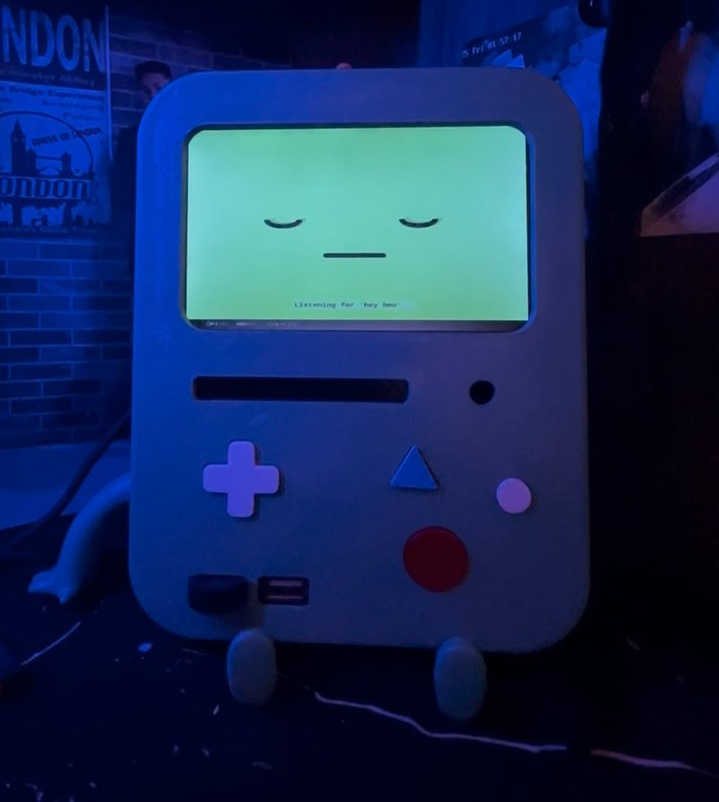
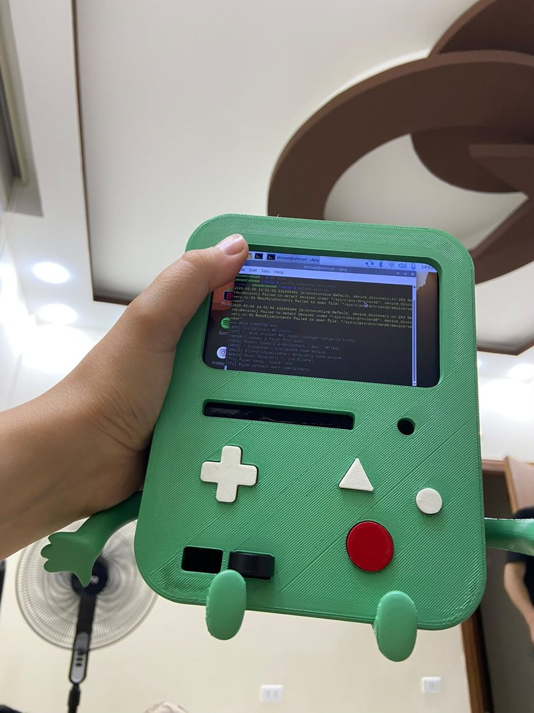
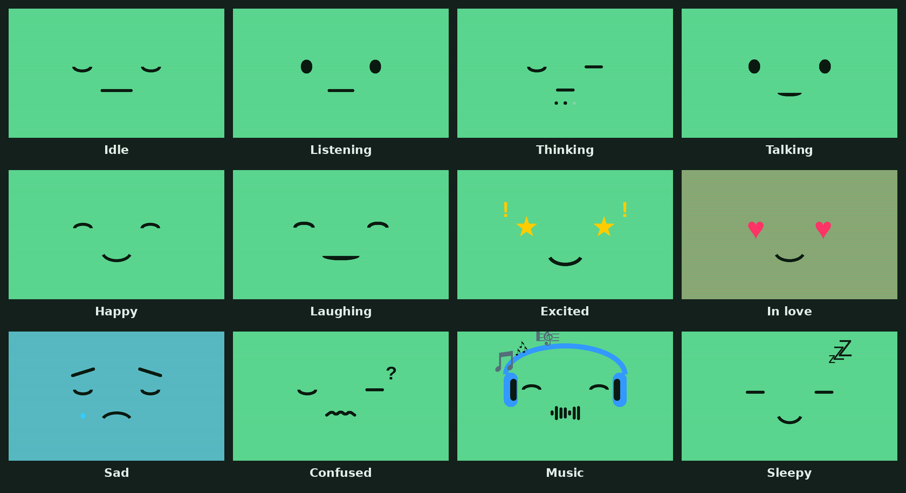
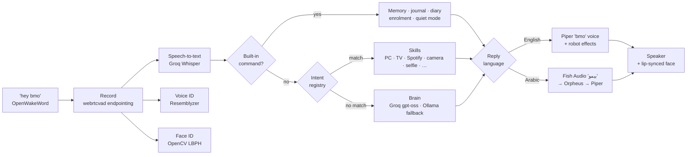
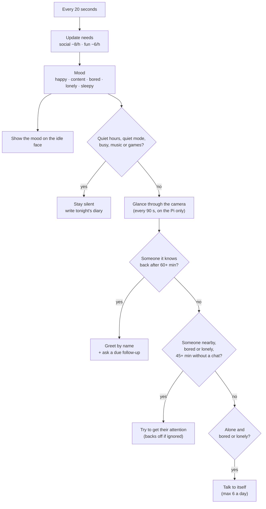

<div align="center">



# BMO

**A real-life BMO from *Adventure Time*: a living, talking, seeing companion built on a Raspberry Pi 5.**

Say "hey bmo" and it answers in BMO's voice, in English or Arabic, with a face that shows how it feels.
It recognises the people it knows, notices when you come home, remembers what you told it,
gets bored when ignored, plays pretend when it's alone, and writes its own diary every night.


</div>

---

## Contents

1. [Meet BMO](#meet-bmo)
2. [What BMO can do](#what-bmo-can-do)
3. [Voice commands](#voice-commands)
4. [How it works](#how-it-works)
5. [Performance](#performance)
6. [Hardware](#hardware)
7. [Installation](#installation)
8. [Configuration](#configuration)
9. [Windows PC control](#windows-pc-control)
10. [Data and privacy](#data-and-privacy)
11. [Project layout](#project-layout)
12. [Troubleshooting](#troubleshooting)
13. [Credits](#credits)

---

## Meet BMO

<p align="center">
<br>
<em>The 3D-printed body during a boot. The arms and legs are part of the print.</em>
</p>

BMO is a 3D-printed BMO body with a Raspberry Pi 5 inside. The screen is its face, a USB microphone is its ears, a USB speaker is its voice and a Raspberry Pi camera is its eye. Everything BMO does is in this repository: hearing the wake word, understanding speech, thinking, talking, drawing its face, controlling the house, and the "inner life" that makes it feel alive.

### BMO's faces

The face is not a set of pictures. It is drawn live in code (`bmo/faces.py`), so it can blink, breathe, look around, ease smoothly from one expression to the next and move its mouth in time with speech. These are rendered directly from that code:



There are 18 faces in total. Besides the 12 above: angry, upset, TV mode (square eyes), meme, camera and error. The brain can choose a face by ending its reply with a tag such as `[HAPPY]`, and some words in the reply also trigger one. Talking about music shows the headphones, and saying sorry shows the sad face.

---

## What BMO can do

### Talking and listening

- **Hands-free wake word.** A custom OpenWakeWord model listens for "hey bmo" all the time (`wakeword/hey bmo.onnx`). Without a wake word model, BMO falls back to push-to-talk with the Enter key.
- **Knows when you've finished.** Recording stops about a second after you stop talking. BMO decides this with webrtcvad speech detection on a filtered signal, not by loudness: the USB mic runs auto-gain and picks up fan rumble, so a volume threshold was never reliable. If it can't clearly tell, it listens for a fixed 3.5 seconds, and it keeps listening as long as you're still talking.
- **Hears quiet voices.** Every recording goes to speech-to-text, even when the voice was faint. Whisper's habit of "hearing" *Thank you.* in silence is filtered out, so false wakes end quietly instead of with a reply to nothing.
- **Interrupt it any time.** Saying "hey bmo" while it talks cuts it off and starts listening. While speaking, it uses a stricter wake threshold so its own voice can't wake it. Saying "stop", "cancel", "be quiet" or "shut up", or pressing Space, also interrupts.
- **Speech-to-text:** Groq's Whisper (`whisper-large-v3-turbo` for English, `whisper-large-v3` for Arabic and bilingual mode), with local Whisper as an offline fallback.
- **The brain:** Groq's `gpt-oss-120b` (or the faster `gpt-oss-20b`) with BMO's personality: short, playful, a little unhinged, and it swears back if you swear at it. A local Ollama model (`llama3.2:3b`) takes over if Groq is unreachable, and the conversation history is mirrored so nothing is lost when it switches.
- **The voice:** a custom Piper voice trained on BMO clips, run through sox for BMO's robot sound (pitch down, a short echo and a phaser). Piper runs inside BMO's own process, so a short reply starts playing in about half a second. Speech is lip-synced on the face, syllable by syllable.

### Two languages (English and Arabic)

With `"language": "auto"`, BMO is bilingual. Whisper works out which language you spoke on every turn. Speak Arabic and BMO answers in everyday **Saudi dialect**, not formal فصحى. Speak English and it answers in English. Each sentence is sent to the right voice based on its script:

| Reply language | Voice | If that fails |
|---|---|---|
| English | Piper "bmo" voice with robot effects | espeak |
| Arabic | Fish Audio "بيمو" BMO voice, streamed as it's generated | Groq Orpheus Saudi (Sultan), then the local Piper Arabic voice (Kareem) |

In a test on real recordings, the language was detected correctly 42 times out of 43, including Saudi speakers mixing English words into their Arabic. You can also force one language with `"language": "english"` or `"language": "arabic"`.

### BMO's inner life

This is what makes BMO different from a normal assistant: it does things on its own (`bmo/life.py`).

**Needs and moods.** BMO has two needs that drift over time. *Social* drops about 8 points an hour when nobody talks to it, and *fun* drops about 6 points an hour when nothing fun happens. Talking raises social, and games, jokes, roasts, music and selfies raise fun. Together with the clock, they give BMO a mood:

| Mood | When | What changes |
|---|---|---|
| Happy | Lots of company and fun | Cheerful replies |
| Content | Normal | Nothing special |
| Bored | Fun below 30 | Asks you to play; talks to itself when alone |
| Lonely | Social below 30 | Sad face when idle; "finally someone talks to me!" |
| Sleepy | Quiet hours (23:00 to 08:00) | Sleepy face; yawns if you wake it |

At the start of a conversation, the mood is quietly passed to the brain, so it colours the reply without BMO announcing it.

**Things BMO does on its own:**

| Behaviour | When it happens |
|---|---|
| **Greets you by name** | The camera sees someone it knows come back after at least an hour away. On a new day it's "good morning". |
| **Follows up** | You mentioned an exam, a trip, a party or feeling sick. When it's over, BMO asks how it went. Timing is worked out from what you said, e.g. the next day for an evening event. |
| **Gets your attention** | It's bored or lonely, someone is nearby, and nobody has talked to it for 45 minutes: "Psst, wanna play a game?" If it's ignored, it waits twice as long next time. |
| **Talks to itself** | It's alone and bored: plays detective, cooks something weird, chats with Football (its reflection), makes up a song. At most 6 times a day, at least 75 minutes apart. |
| **Writes a diary** | Every night at the start of quiet hours, it writes a short diary entry about its day from what actually happened. Ask "how was your day?" anytime. |

**It's never annoying by design.** It stays silent during quiet hours, while music, games or lo-fi mode are playing, and while anything is on screen. It leaves at least 20 minutes between unprompted lines and never talks over you. "Quiet mode" or "leave me alone" silences it for 3 hours, and "you can talk again" undoes that. Camera glances for noticing people happen about every 90 seconds while BMO is awake. They run entirely on the Pi and nothing is sent anywhere.

### The camera eye

- **"What do you see?"** BMO takes a photo and describes it in character, using Groq's vision model (`qwen/qwen3.8-27b`).
- **"Read this"** reads text held up to the camera out loud.
- **"Roast me" / "rate my outfit"** gives a playful, good-natured roast of your outfit or vibe. It never comments on someone's body, race or age.
- **Selfies.** Say "selfie": the screen becomes a live mirrored camera preview at about 15 frames a second, BMO says "Selfie time!" and counts down 5 to 1 with big numbers on screen, then a shutter click, a white flash, and your photo for 4 seconds. The countdown is pre-recorded in BMO's voice, so the sound lands at the same instant as the number on screen. Photos are saved in `data/selfies/` and numbered in BMO's album.
- One thing uses the camera at a time. Vision, face recognition, selfies and BMO's glances take turns instead of failing with "camera busy".

### Recognising people

- **Face ID.** "Remember my face as Ahmad" takes 5 photos. BMO then recognises that face (OpenCV face detection with an LBPH recogniser) to greet people by name and to know who's talking when it can't tell from the voice.
- **Voice ID.** "Remember my voice as Ahmad" learns a voice (Resemblyzer). BMO then knows who's speaking on every turn, in parallel with speech-to-text, so it adds no delay.
- **Owner lock.** Set `voice_id_owner` and the risky commands only work in your voice: PC control, powering off the Pi, Instagram posting and self-coding. BMO politely refuses anyone else.

### Memory

- **Facts about you.** BMO picks up things like "my name is…", "I'm 24 years old", "I live in…", "I like…", "I don't like…", "my job is…" and "my hobby is…", and keeps them in mind in every conversation.
- **Conversation recall.** "What did I say about my trip?" searches past conversations by meaning, using local embeddings through Ollama, not exact words.
- **Mood journal.** At 21:30 BMO asks how your day was and logs your answer with a mood. "How have I been feeling?" reads it back.
- "Forget everything" clears the current conversation. "Forget everything about me" wipes the facts and the recall memory.

### Screen

- The face, with smooth movement, blinking, breathing, lip sync and mood faces when idle.
- **HUD bars:** clock and date, the current Spotify song and Instagram followers at the top, and CPU, RAM and temperature at the bottom.
- **Media:** memes (optionally on a topic), images from a URL or a local `pictures/` folder, the Instagram QR code, and the live selfie preview. "Close the image" brings the face back.
- Colour boost settings (`face_saturation_boost`, `face_brightness_boost`) compensate for screens that wash out colours.

### Around the house

- **Windows PC** through a small agent running on the PC: wake it (Wake-on-LAN), lock, sleep, restart, shut down, open and close apps ("open Valorant on my pc"), volume and mute, YouTube or Spotify, screenshots, read the clipboard, top processes, GPU temperature and how long you've been playing a game. See [Windows PC control](#windows-pc-control).
- **TV.** Android TV over ADB (power, volume, mute, open apps, YouTube search, inputs, channels, remote keys, pairing). Roku, HDMI-CEC, Samsung SmartThings and simple HTTP devices are also supported through `tv_type`.
- **Spotify.** Play, pause, resume, next and previous, volume, and what's playing. When music plays, the face switches to DJ mode with headphones.
- **Home Assistant.** Turn lights on and off by name.

### Instagram

BMO can run its own Instagram account:
- A daily post (10:00) and story (18:00) with a generated BMO "card" image, a caption in BMO's voice and hashtags on a theme you choose.
- It replies to new comments in character every 30 minutes.
- Follower stats on request and in the HUD, and the account's QR code on screen.

### Fun

- **Games.** "Let's play games" launches RetroArch fullscreen. BMO hides behind it and comes back the moment you quit.
- **Lo-fi mode.** "Chill", "relax" or "study mode" streams lo-fi radio with a music face.
- Jokes, facts, things to do when you're bored, and memes.

### Helpers

Weather anywhere, news headlines, web search with a spoken summary, timers, listing and cancelling alarms, notes ("note that…", find, list, delete), safe maths, Pi system status and which brain is active.

### Teaches itself new skills

"Learn a new skill that tells the time in Tokyo" makes BMO write a new Python skill with `gpt-oss-120b`, test it and load it straight away. Skills it writes are saved in `dynamic_skills/` and load at every start. Only the owner's voice can do this.

### Web control page

BMO serves a small control page on port 8080 (`http://<pi-address>:8080`). It shows BMO's status and the current song, and lets you send a command or make BMO say something. The API endpoints `/api/command` and `/api/speak` need the `X-BMO-Token` header, which is the `api_token` from `config.json`, generated on the first start. `/api/status` is open.

---

## Voice commands

Start with **"hey bmo"**. Most commands have several phrasings, and the examples below are tested against the real intent matcher. Anything that isn't a command goes to the brain as normal conversation, in English or Arabic.

| Area | Say |
|---|---|
| **Chat** | anything: "how are you?", "tell me a story", "هلا بيمو، وش مسوي اليوم؟" |
| **BMO's day** | "how was your day?", "what did you do today?", "read me your diary", "what did you do yesterday?" |
| **Quiet** | "quiet mode", "leave me alone", "be quiet for a while" (3 hours) · "you can talk again" |
| **Interrupt** | "stop", "cancel", "be quiet", "shut up", or "hey bmo" while it's talking |
| **Camera** | "what do you see?", "can you see me?", "what do I look like?", "read this", "look through your camera" |
| **Roast** | "roast me", "roast my fit", "rate my outfit", "judge my look" |
| **Selfie** | "selfie", "take a selfie" |
| **Faces** | "remember my face as Ahmad", "forget Ahmad's face", "whose faces do you know?" |
| **Voices** | "remember my voice as Ahmad", "forget Ahmad's voice", "who do you recognize?", "who's talking?" |
| **Memory** | "what do you remember about me?", "what did I say about …", "forget everything", "forget everything about me" |
| **Journal** | "read my journal", "how have I been feeling?" |
| **PC** | "turn on my pc", "open Valorant on my pc", "close Chrome on my pc", "lock my computer", "sleep my pc", "shut down my computer", "restart my pc", "mute my pc", "set volume to 40 on my pc", "open youtube on my pc", "take a screenshot", "read my clipboard", "what's running on my pc", "gpu temp", "how long have I been playing Valorant?" |
| **TV** | "turn on the tv", "turn off the tv", "tv volume up", "mute the tv", "open Netflix on the tv", "search cat videos on youtube" |
| **Spotify** | "play Daft Punk on spotify", "pause", "resume music", "next song", "previous song", "what is playing" |
| **Home** | "turn on the living room light", "turn off the bedroom light" |
| **Instagram** | "post on instagram", "post a story", "check instagram comments", "instagram followers", "show my instagram qr" |
| **Fun** | "let's play games", "stop games", "chill" / "relax" (lo-fi), "stop relax", "show me a meme", "show me a meme about cats", "tell me a joke", "tell me a fact", "I'm bored" |
| **Helpers** | "weather in Riyadh", "latest news", "search for …", "set a 10 minute timer", "set a timer for 30 seconds", "list my alarms", "cancel the morning alarm", "note that …", "calculate 12 times 4" |
| **Self-coding** | "learn a new skill that …", "write a skill to …" |
| **System** | "system status", "brain status", "close the image" |

Device commands understand English phrases only. Arabic always works for conversation.

---

## How it works

### One turn, start to finish



1. **Wake.** OpenWakeWord scores every 80 ms of audio against the "hey bmo" model. Above `wake_threshold`, BMO plays a chime and starts recording.
2. **Record.** Each 30 ms frame is high-passed at 200 Hz, which removes fan and table rumble, and classified as speech or not by webrtcvad. Recording stops once the last second is quiet, or after `no_speech_timeout` if no clear speech was heard.
3. **Understand.** The recording goes to Whisper. At the same time, voice ID and a camera face check run in parallel threads, so knowing who's talking costs no extra time.
4. **Decide.** Built-in commands are checked first (memory, journal, enrolment, quiet mode, BMO's day). Then the intent registry (`bmo/skills/registry.py`) tries its ordered patterns. A match runs a skill right away, without the LLM.
5. **Think.** Anything else goes to the brain, with a few notes added: who is speaking, BMO's current mood, a welcome back if they've been away, a follow-up if one is due, and "reply in Saudi Arabic" if you spoke Arabic.
6. **Speak.** The reply is split into sentences, each sentence goes to the English or Arabic voice by its script, and the mouth moves in time. When it's done, BMO goes straight back to listening.

### BMO's inner life loop



When BMO asks something on its own, such as a greeting with a question, a follow-up or the nightly check-in, it listens once for your answer without the wake word. If nobody answers, it goes back to idle and gives people more space next time.

### What runs at the same time

| Worker | Job |
|---|---|
| Main loop | Wake word, recording, understanding, deciding, replying |
| Speech worker | Speaks queued sentences one by one with lip sync |
| Face and screen | Redraws the face and HUD several times a second |
| Inner life | Needs, moods, glances, things BMO does on its own, the diary (every 20 s) |
| Journal | Nightly check-in at `checkin_time` |
| Alarms | Fires saved alarms and reminders |
| Instagram | Scheduled posts, stories and comment replies |
| Web server | Control page and API on port 8080 |

### When something fails

| Part | First choice | Then | Then |
|---|---|---|---|
| Wake word | OpenWakeWord "hey bmo" | Push-to-talk (Enter key) | |
| Speech-to-text | Groq Whisper | Local Whisper (`tiny.en`) | |
| Brain | Groq `gpt-oss` | Ollama `llama3.2:3b` | "My brain is offline" |
| English voice | Piper "bmo" + robot effects | espeak | |
| Arabic voice | Fish Audio "بيمو" | Groq Orpheus Saudi (Sultan) | Piper Arabic (Kareem) |
| Camera | `rpicam-still` / `rpicam-vid` | Camera features turn themselves off | |
| Optional pieces | TV, Spotify, Home Assistant, GPIO LEDs, Instagram | Missing or failing ones are skipped; BMO keeps running | |

---

## Performance

Measured on this Raspberry Pi 5:

| Step | Time |
|---|---|
| Recording ends after you stop talking | about 0.75 s (when speech is clearly detected) |
| Speech-to-text (Groq Whisper) | 0.3–0.5 s |
| Brain reply (Groq `gpt-oss`) | 0.3–1.0 s |
| English voice starts after the reply is ready | about 0.4–0.5 s |
| Arabic voice (Fish Audio) starts | about 0.8 s |
| Selfie preview | about 15 frames a second |
| Selfie countdown sound vs screen | 0.04 s apart |

Accuracy checks from development:

| Test | Result |
|---|---|
| Language detection on 43 real clips (English and Saudi Arabic) | 42 correct |
| Word errors on 25 real Saudi speakers, `whisper-large-v3` | 38.6% (turbo: 43.3%) |
| Arabic BMO voice read back by Whisper | 4.3% of characters wrong |
| Speech detection in 15 s of real room noise | correctly ignored; gives up after the timeout |

The speed work that got it here: Piper moved into BMO's own process (short replies used to start about 2 seconds late), the speaker now starts after 0.1 s of audio instead of waiting for half a second, and recording stops when you stop talking instead of after a fixed window.

---

## Hardware

| Part | Notes |
|---|---|
| Raspberry Pi 5 (8 GB) | Runs everything. The heavy AI work happens in the cloud (Groq, Fish Audio) or locally where it's light. |
| Screen | An HDMI display behind BMO's screen window. This BMO runs at 1024×768. |
| Microphone | A USB microphone ("USB PnP Sound Device"). Set `input_device` to part of its name. |
| Speaker | A USB audio device. BMO finds it automatically. |
| Camera | Raspberry Pi camera, OV5647 (5 MP), on the camera port. |
| Body | 3D-printed BMO case with the D-pad, triangle and round buttons, arms and legs. |
| Optional | 4 status LEDs on GPIO 17 (idle), 27 (listening), 22 (thinking) and 23 (speaking), each through a 220 Ω resistor. Enable with `led_enabled`. |
| Power | A good 5 V USB-C supply for the Pi 5 (the official 27 W one). |

Tips from building it:
- **Keep the microphone away from fans** and anything that vibrates. The USB mic's auto-gain turns itself down when there's rumble, which makes your voice faint.
- **Point the camera where people sit or stand**, so greetings and "can you see me?" work.

---

## Installation

These steps assume Raspberry Pi OS (64-bit). This BMO runs Debian 13 "trixie" with Python 3.13.

**1. Get the code**

```bash
git clone https://github.com/ahmad3a4/bmo.git ~/aria
cd ~/aria
```

**2. Run the setup script**

```bash
bash setup.sh
```

It installs the system packages (PortAudio, ALSA, sox, ffmpeg, espeak), Piper and a default voice, generates the sound effects, creates a Python virtual environment, installs the Python packages, downloads the wake word model, installs Ollama with `llama3.2:3b`, creates the data folders, and finally asks whether to install a systemd service so BMO starts on boot.

**3. Python packages**

```bash
source venv/bin/activate
pip install -r requirements.txt
pip install openwakeword --no-deps
```

OpenWakeWord is installed without its dependencies on purpose, to avoid a `tflite-runtime` incompatibility with Python 3.13 on the Pi 5.

**4. Voices**

- **BMO's English voice:** put `bmo.onnx` and `bmo.onnx.json` in `voices/`. Voice models are not stored in git because of their size.
- **The offline Arabic fallback voice:** `bash download_arabic_voice.sh`. It checks the file against the server's size, so a cut-off download can't pass as complete.

**5. Camera**

```bash
rpicam-hello --list-cameras
```

You should see your camera listed (for example `ov5647`).

**6. Settings**

```bash
cp config.example.json config.json
nano config.json
```

At minimum, add a `groq_api_key` (free at console.groq.com). For the full BMO experience:

```json
{
  "assistant_name": "BMO",
  "user_name": "Ahmad",
  "groq_api_key": "gsk_...",
  "groq_model": "smart",
  "language": "auto",
  "wake_word_model": "hey bmo",
  "voice_model": "bmo",
  "input_device": "usb pnp",
  "voice_id_owner": "Ahmad",
  "fish_audio_api_key": "sk-fish-...",
  "fish_audio_model": "s2.1-pro-free"
}
```

Anything you leave out uses the defaults in `bmo/config.py`.

**7. Run**

```bash
python aria.py              # with the face on screen
python aria.py --headless   # without a screen
python aria.py --test       # check the components
```

Run `aria.py` from the project root, not as `python -m bmo`, so the skills BMO writes for itself in `dynamic_skills/` can be imported.

Keyboard: **Enter** for push-to-talk, **Space** to interrupt, **Esc** to quit.

To start on boot with the service from `setup.sh`: `sudo systemctl enable --now aria`.

**8. Teach BMO who you are**

Say "hey bmo, remember my face as Ahmad" and "hey bmo, remember my voice as Ahmad". Then set `voice_id_owner` to your name, so the risky commands only answer to you.

**Optional pieces**

| Feature | What to do |
|---|---|
| Spotify | Add `spotify_client_id` and `spotify_client_secret`, then run `python bmo/tools/spotify_setup.py` once. |
| Windows PC | See [Windows PC control](#windows-pc-control). |
| Android TV | Turn on ADB debugging on the TV, set `tv_type` to `adb` and `adb_tv_ip`, then say "connect to the tv". |
| Home Assistant | Set `home_assistant_url` and a long-lived `home_assistant_token`. |
| Instagram | Set `instagram_username` and `instagram_password`, or import a browser session with the scripts in `bmo/tools/`. |
| Arabic BMO voice | Add a Fish Audio API key as `fish_audio_api_key`. Use `"fish_audio_model": "s2.1-pro-free"` for Fish's free model. |
| Lo-fi mode | Needs `mpv` (or VLC's `cvlc`) for the radio streams. |
| Games | Install RetroArch (`sudo apt install retroarch`), or point `retroarch_bin` at it. |

---

## Configuration

`config.json` only needs the values you want to change. Everything else falls back to `bmo/config.py`.

### Core

| Key | Default | What it does |
|---|---|---|
| `assistant_name` | `ARIA` | BMO's name (set it to `BMO`) |
| `user_name` | — | Your name; BMO treats you as its creator and best friend |
| `language` | `english` | `english`, `arabic`, or `auto` (bilingual, detected every turn) |
| `groq_api_key` | — | Needed for speech-to-text, the brain and vision |
| `groq_model` | `turbo` | `turbo` / `fast` = gpt-oss-20b, `smart` = gpt-oss-120b |
| `ollama_model` | `llama3.2:3b` | Offline fallback brain |
| `whisper_model` | `tiny.en` | Local Whisper, used only if Groq is unreachable |
| `chat_memory_turns` | `12` | How many back-and-forth turns BMO keeps in mind |

### Hearing

| Key | Default | What it does |
|---|---|---|
| `wake_word_model` | `alexa` | Use `hey bmo` for the custom model in `wakeword/` |
| `wake_threshold` | `0.5` | Lower wakes more easily, and also on more noise |
| `wake_threshold_during_tts` | `0.6` | Stricter threshold while BMO talks, so it can't wake itself |
| `silence_duration` | `1.5` | Seconds of quiet before BMO decides you've finished |
| `no_speech_timeout` | `3.5` | How long BMO listens when it can't clearly hear speech |
| `max_record_seconds` | `25` | The longest a single recording can be |
| `input_device` / `output_device` | auto | Part of the device name (e.g. `usb pnp`) or its number |
| `input_sample_rate` | auto | Force a microphone sample rate |
| `silence_threshold` | `0.006` | Only used if webrtcvad isn't installed |

### Voice

| Key | Default | What it does |
|---|---|---|
| `voice_model` | `en_GB-alan-medium` | Piper voice in `voices/`; use `bmo` for BMO's voice |
| `robotic_fx` | `true` | BMO's robot effect on the English voice |
| `sound_effects` | `true` | Wake, done and error chimes |
| `fish_audio_api_key` | — | Fish Audio key for the Arabic BMO voice |
| `fish_audio_voice` | `33c6…9286` | The Fish voice to use (the "بيمو" voice) |
| `fish_audio_model` | `s2.1-pro` | `s2.1-pro-free` for Fish's free model |
| `arabic_tts_voice` | `sultan` | Groq Orpheus Saudi voice used when Fish fails |
| `arabic_tts_model` | `canopylabs/orpheus-arabic-saudi` | Groq's Arabic voice model |
| `arabic_fallback_voice_model` | `ar_JO-kareem-low` | Local Piper Arabic voice, the last fallback |

### Eyes, faces and people

| Key | Default | What it does |
|---|---|---|
| `vision_model` | `qwen/qwen3.8-27b` | Groq vision model for "what do you see" and roasts |
| `face_id_enabled` / `face_id_threshold` | `true` / `70` | Face recognition; lower is stricter |
| `voice_id_enabled` / `voice_id_threshold` | `true` / `0.65` | Voice recognition; higher is stricter |
| `voice_id_owner` | — | Your name; locks risky commands to your voice |
| `face_saturation_boost` / `face_brightness_boost` | `1.0` / `1.0` | Make the face colours pop on a dull screen |

### Inner life

| Key | Default | What it does |
|---|---|---|
| `life_enabled` | `true` | Turns the whole inner life on or off |
| `life_quiet_start` / `life_quiet_end` | `23:00` / `08:00` | BMO never talks on its own in this window |
| `life_away_minutes` | `60` | How long someone must be gone before BMO greets them |
| `life_idle_minutes` | `45` | How long without attention before BMO tries to get some |
| `life_min_gap_minutes` | `20` | Minimum time between unprompted lines |
| `life_glance_seconds` | `90` | How often BMO glances through the camera while awake |
| `life_talk_to_self` | `true` | Let BMO play pretend when it's alone |
| `checkin_enabled` / `checkin_time` | `true` / `21:30` | The nightly "how was your day?" |

### Memory

| Key | Default | What it does |
|---|---|---|
| `semantic_memory_enabled` | `true` | "What did I say about…" recall |
| `semantic_embed_model` | `all-minilm` | Ollama embedding model for recall |
| `semantic_recall_threshold` | `0.35` | How closely a memory must match to be recalled |

### House and accounts

| Key | Default | What it does |
|---|---|---|
| `pc_ip` / `pc_mac` | — | Your PC's address, and its MAC for Wake-on-LAN |
| `pc_agent_token` | — | Shared secret with the PC agent |
| `tv_type` | `cec` | `adb`, `roku`, `cec`, `samsung` (SmartThings) or `http` |
| `adb_tv_ip` / `adb_tv_port` | — / `5555` | Android TV address |
| `smartthings_token` / `smartthings_device_id` | — | For Samsung TVs |
| `spotify_client_id` / `spotify_client_secret` / `spotify_redirect_uri` | — / — / `http://localhost:8888/callback` | Spotify app credentials |
| `home_assistant_url` / `home_assistant_token` | — | Home Assistant |
| `news_count` | `5` | Headlines per news request |
| `api_token` | generated | Token for the web API |
| `retroarch_bin` | `retroarch` | RetroArch command |
| `led_enabled` + `led_*_pin` | `false`, 17 / 27 / 22 / 23 | Optional GPIO status LEDs |

### Instagram

| Key | Default | What it does |
|---|---|---|
| `instagram_username` / `instagram_password` | — | Account login |
| `instagram_post_enabled` / `instagram_post_time` | `true` / `10:00` | Daily post |
| `instagram_story_enabled` / `instagram_story_time` | `true` / `18:00` | Daily story |
| `instagram_replies_enabled` / `instagram_reply_interval_minutes` | `true` / `30` | Replying to comments |
| `instagram_theme` | BMO adventures… | What posts are about |
| `instagram_headless` | — | Run the browser automation without a window |

---

## Windows PC control

BMO controls a Windows PC through `bmo_pc_agent.py`, a small HTTP agent on port 8080 of the PC. Every request carries a shared token, and the agent refuses anything without it.

1. Copy `bmo_pc_agent.py` and `install_pc_agent_task.ps1` to a folder on the PC (for example `C:\BMO`).
2. In PowerShell, from that folder:
   ```powershell
   .\install_pc_agent_task.ps1 -Token "<pc_agent_token from config.json>"
   ```
   This saves the token for your user and creates a task that starts the agent at every login, with no console window. If you leave out `-Token`, it asks for it without showing what you type.
3. Allow port 8080 through Windows Firewall, and set your network to Private.
4. Set `pc_ip` and `pc_mac` in BMO's `config.json` (the MAC address is for "turn on my pc" over Wake-on-LAN).

The agent can open and close apps, lock, sleep, restart and shut down, change and mute the volume, open YouTube or Spotify, take screenshots, read the clipboard, list the top processes, read the GPU temperature and tell you how long a game has been running. Logs go to `pc_agent_log.txt` next to the agent.

---

## Data and privacy

Everything personal stays in `data/`, which is excluded from git.

| File / folder | What it holds |
|---|---|
| `memory.json` | Facts BMO learned about you |
| `semantic_memory.json` | Past conversation snippets for recall |
| `journal.json` | Your nightly check-in answers and moods |
| `voiceprints.json` | Voice enrolments |
| `known_faces/` | Face enrolments |
| `selfies/` | Selfies |
| `life_state.json` | BMO's needs, mood, the day's events and pending follow-ups |
| `bmo_diary.json` | BMO's diary |
| `alarms.json`, `reminders.json` | Saved alarms and reminders |
| `ig_*.json`, `ig_tmp/` | Instagram session and history |
| `cache/` | Pre-rendered sounds (for example the selfie countdown) |

`config.json` (all keys and passwords) is excluded from git too. Use `config.example.json` as the template.

**What leaves the Pi:**
- Recorded speech goes to Groq for speech-to-text.
- Conversation text goes to Groq for the brain.
- Arabic replies go to Fish Audio, or Groq, to be spoken.
- Camera photos are sent only when you ask BMO to look ("what do you see", "read this", "roast me").

**What stays on the Pi:**
- The camera glances for greetings, and face recognition. Each glance overwrites the last one in `/tmp`.
- Voice recognition, the inner life, the diary, and the recall memory, which uses local Ollama embeddings.

---

## Project layout

```
aria.py                     Entry point (run from the project root)
bmo/
  agent.py                  Main loop: wake word, recording, deciding, replying, screen
  brain.py                  Speech-to-text, the brain (Groq / Ollama), voices, memory
  life.py                   Inner life: needs, moods, things BMO does on its own, diary
  vad.py                    Speech endpointing (started talking? finished?)
  camera.py                 Shared camera access, one user at a time
  face_id.py                Face recognition
  voiceprint.py             Voice recognition
  journal.py                Nightly check-in and mood journal
  semantic_memory.py        "What did I say about…" recall
  faces.py                  The code-drawn animated face
  hud.py                    Top and bottom status bars
  media.py                  Memes, images and the live camera preview on screen
  alarms.py                 Alarms and reminders
  ambient.py                Lo-fi mode
  games.py                  RetroArch launcher
  tv.py                     TV control (ADB, Roku, CEC, SmartThings, HTTP)
  self_coder.py             Writes new skills
  app.py                    Web control page and API (port 8080)
  config.py                 Default settings
  paths.py                  Every file path in one place
  skills/
    registry.py             Voice phrase patterns → actions, in priority order
    router.py               Runs the action
    vision.py               "What do you see", "read this", roasts
    selfie.py               Live preview, countdown, saved photo
    pc_control.py           Talks to the Windows PC agent
    spotify.py  home_assistant.py  notes.py  misc.py
  instagram/                Scheduler, captions, card images, browser automation
  tools/                    One-off setup scripts (Spotify login, Instagram session import)
bmo_pc_agent.py             The agent that runs on your Windows PC
install_pc_agent_task.ps1   Starts the PC agent at Windows login
setup.sh                    Raspberry Pi setup
download_arabic_voice.sh    Downloads the offline Arabic voice
wakeword/                   Wake word models ("hey bmo")
assets/                     Face detection model
sounds/                     Chimes
web/                        Control page
docs/images/                Pictures for this README
dynamic_skills/             Skills BMO wrote for itself
voices/                     Piper voices (not in git)
data/                       Everything personal (not in git)
```

---

## Troubleshooting

**BMO doesn't hear me, or only sometimes.**
Each recording logs how much speech was heard, e.g. `[REC] Finished. Duration: 1.9s, speech: 0.9s (strong)`. If you often see `(none)` or `(weak)` while talking, your voice is reaching the mic too quietly. Move the mic closer to where you talk and away from fans. A better USB microphone helps more than any setting.

**BMO wakes up by itself.**
`wake_threshold` is too low. False wakes are harmless, because BMO gives up quietly if nobody speaks. But a very low threshold also lets a TV or video wake it.

**The Arabic voice sounds robotic or different.**
Look for `[TTS] Fish Audio HTTP 402` in the log. It means your Fish account has no API credit for the chosen model. Set `"fish_audio_model": "s2.1-pro-free"` or add credit. Without Fish, BMO uses Groq's Saudi voice, which the free Groq plan limits to 100 requests a day, and then the local voice.

**BMO doesn't greet me when I come home.**
Greetings need a face enrolment ("remember my face as …") and the camera able to see you. BMO also stays quiet during quiet hours, in quiet mode, and while music, games or anything on screen is active.

**"Chill" starts music instead of quieting BMO.**
"Chill" is lo-fi mode. To make BMO stop talking on its own, say "quiet mode" or "leave me alone".

**A Spotify command goes to chat.**
Name Spotify: "play Daft Punk on spotify". Use "what is playing" for the current song.

**Setting alarms or reminders by voice doesn't work.**
Voice can list and cancel them, but setting new ones by voice isn't wired up yet. Timers do work: "set a 10 minute timer".

**The log shows `onnxruntime … Failed to detect devices under /sys/class/drm`.**
Harmless. ONNX Runtime looks for a GPU the Pi doesn't have.

**"Camera busy — skipped."**
Something else was using the camera at that moment. BMO's camera features take turns and retry.

---

## Credits

Made by **Ahmad** ([@ahmad3a4](https://github.com/ahmad3a4)).

BMO and *Adventure Time* belong to Cartoon Network. This is a personal fan project with no connection to them.

Built with [OpenWakeWord](https://github.com/dscripka/openWakeWord), [Piper](https://github.com/OHF-Voice/piper1-gpl), [Whisper](https://github.com/openai/whisper), [Groq](https://groq.com), [Ollama](https://ollama.com), [Fish Audio](https://fish.audio), [webrtcvad](https://github.com/wiseman/py-webrtcvad), [OpenCV](https://opencv.org), [Resemblyzer](https://github.com/resemble-ai/Resemblyzer), [sox](https://sourceforge.net/projects/sox/), RetroArch and the Raspberry Pi camera stack.
